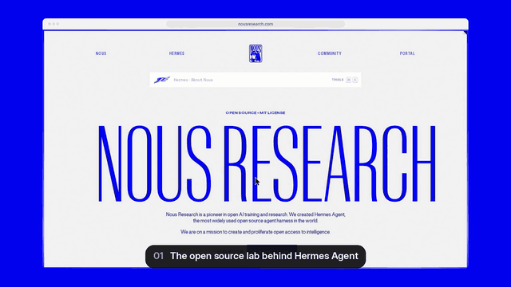
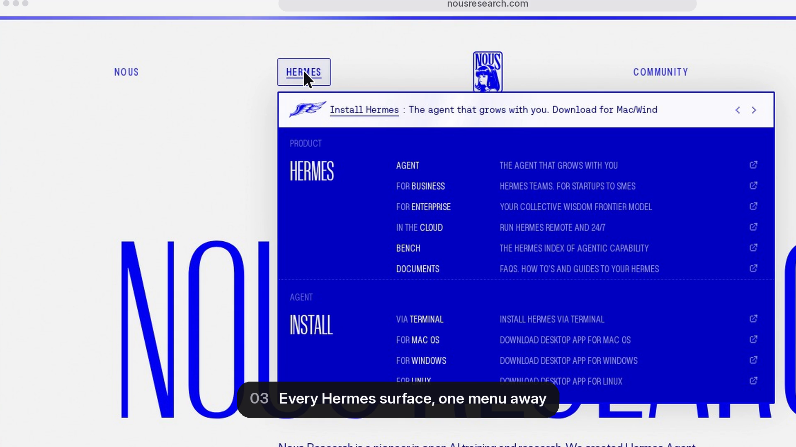
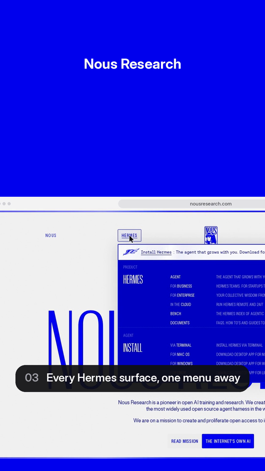
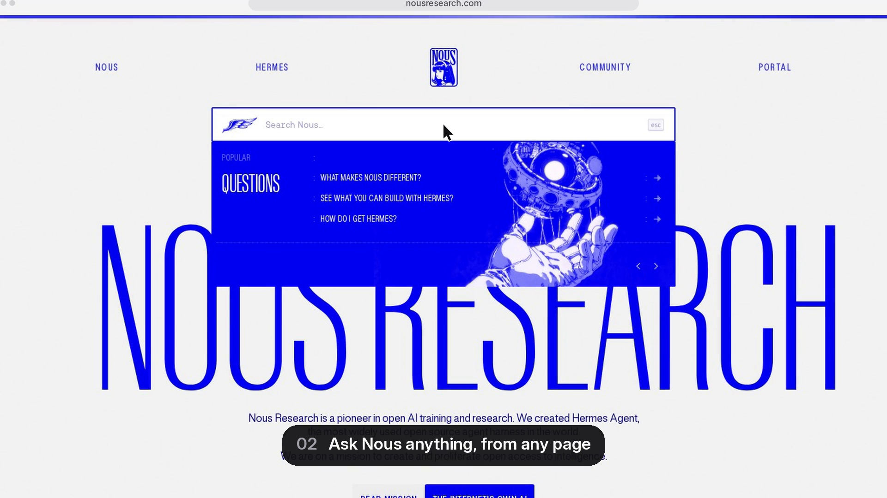
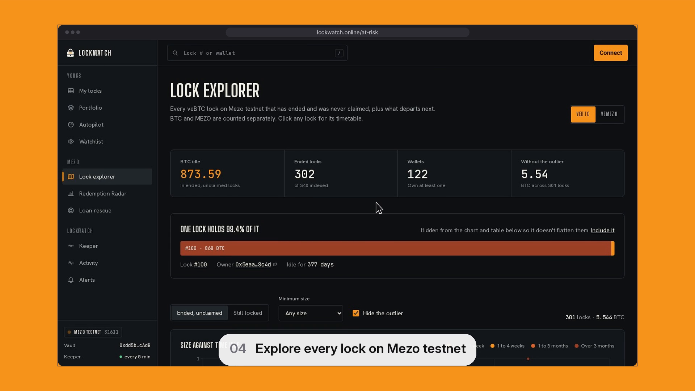
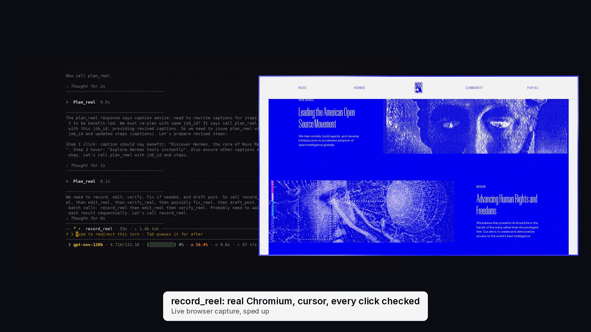

# Ship Reel

A Hermes Agent plugin that turns a URL and one sentence into a finished product demo reel.
Hermes plans the shot list, Ship Reel records it in a real browser, edits it like a
screen-recording studio would, checks the result, fixes what failed, and drafts the post.
It never publishes anything itself.



```
> Make a launch reel of https://nousresearch.com: show the search palette,
  the Hermes menu, and how to install.
```

Hermes calls `plan_reel`, `record_reel`, `edit_reel` and `verify_reel` in turn and hands
back two MP4s: a 1920x1080 cut and a 1080x1920 cut for vertical feeds.

## What a reel gets

- **A real recording, not a slideshow.** Headless Chromium at 2x pixel density, captured
  through the DevTools screencast at about 50 fps, so text stays sharp at 1.6x zoom.
- **Camera work.** Auto-zoom toward each click, typed field and hover, driven by a
  critically damped spring with sub-pixel resampling. It eases in and out and never shows
  the edge of the page.
- **A rendered cursor.** The cursor moves on eased, slightly curved paths and is redrawn
  in post at full resolution, with a ripple on every click.
- **Cuts that hide waiting.** Page loads and client-side route changes become short
  cross-fades. Waits for slow work (`wait` with `until`) become a labelled time-lapse.
- **Numbered captions, a title card and an end card.** Colours come from the page itself,
  using hue-binned brand colour detection, with caption pills that contrast with the page.
- **Voice-over.** Optional narration with Kokoro, a local text-to-speech model, so nothing
  leaves the machine. The captions are the script, or a step can carry its own `say` line.
  Lines are timed to their shots, and the title card and shots hold a little longer when a
  line needs room. Install the extra (`pip install "kokoro-onnx>=0.4,<1"`) and the
  ~120 MB model downloads on the first narrated render, checked against pinned SHA-256
  hashes. Without it, reels render without narration.
- **Music and sound.** A quiet music bed is on by default. It is synthesised by
  `scripts/make_music_bed.py`, so it is covered by this repo's MIT licence with no third-party
  audio. It ducks under the voice-over. Use `music: none` to turn it off, or pass a track
  you have rights to. Click and key sounds are synthesised in code too.
- **A vertical cut.** This is a separate camera pass that follows the cursor, not a
  centre crop.
- **Objective checks.** Duration of 90 s or less, H.264 High with yuv420p, faststart, file
  size, black frames, frozen video, true peak, captions, skipped steps. `fix_reel` repairs
  what it can and re-records when a step was missed.

| Landscape | Vertical |
|---|---|
|  |  |
|  |  |

## Watch Hermes make one



In the meta demo, Hermes Agent takes one typed prompt and calls `plan_reel`,
`record_reel`, `edit_reel`, `verify_reel` and `draft_post` itself. The reel at the end
is the unedited output. See [docs/demo-plan.md](docs/demo-plan.md) for how it was
recorded.

## Install

```bash
hermes plugins install AshThunder/ship-reel
python -m playwright install chromium      # one-time browser download
# ffmpeg and ffprobe must be on PATH (apt install ffmpeg / brew install ffmpeg)
```

Requirements: Hermes Agent 0.21.5 or later, Python dependencies `playwright>=1.44,<2` and
`Pillow>=10.1,<14`, and ffmpeg with ffprobe. No API keys.

Setting (optional, off by default): `allow_private_hosts` lets Ship Reel record localhost
and private-network pages, for example a local dev server. Environment equivalent:
`SHIPREEL_ALLOW_PRIVATE_HOSTS=1`.

Optional voice-over: `pip install "kokoro-onnx>=0.4,<1"` into the Python that runs Hermes.

## Tools

| Tool | What it does |
|---|---|
| `plan_reel` | Validates a URL and brief, takes or drafts a 5 to 8 step shot list (navigate, click, type, scroll, hover, press, wait), normalises it, and dry-runs every step against the live page so bad targets are caught before recording. |
| `record_reel` | Records the plan in headless Chromium. Every click is checked for an effect (URL, DOM or scroll change) and retried with another locator if nothing happened. |
| `edit_reel` | Renders the landscape and vertical cuts in parallel worker processes. Options: `format`, `vertical`, `fps`, `zoom`, `background`, `accent`, `sound`, `music`, `music_volume`, `voice`, `voice_speed`, `speed`. |
| `verify_reel` | Runs ffprobe and ffmpeg analysis and returns pass/fail with reasons. |
| `fix_reel` | Applies fixes for what verify flagged (timing, holds, encoding, size, re-record) and verifies again, up to 3 rounds. |
| `list_reels`, `reel_status` | Job history and full job state. |
| `draft_post` | Drafts post text (280 characters or less, no emojis) and video alt text. It never posts. |

The bundled `ship-reel` skill teaches Hermes the workflow and how to write a good shot list.

## Safety and disclosures

- **Network:** opens the URL you give it, and the pages your shot list visits, in headless
  Chromium. If the optional voice-over is enabled, it downloads the Kokoro model once from
  the kokoro-onnx GitHub release and checks it against pinned SHA-256 hashes. It sends no
  telemetry and calls no other services.
- **Public pages only:** the start URL, `navigate` steps and `cta_url` must resolve (every
  A/AAAA record) to public addresses. Loopback, private (RFC 1918, IPv6 `fc00::/7`),
  link-local (including the `169.254.169.254` metadata address), CGNAT `100.64.0.0/10`,
  unspecified, multicast and reserved ranges are refused, as are their IPv4-mapped forms,
  decimal/octal/hex IP hosts and `user@host` URLs. Inside the browser every request goes
  through a route filter and a local filtering proxy that checks each connection (redirect
  hops, subresources, clicks, websockets) and pins it to the vetted address, so pages cannot
  reach those ranges either. To record a local dev server, set the plugin setting
  `allow_private_hosts: true` (`plugins.entries.ship-reel.settings`) or the environment
  variable `SHIPREEL_ALLOW_PRIVATE_HOSTS=1`. It is off by default and no tool argument can
  turn it on. Known issue: on machines whose DNS goes through a fake-IP proxy (every name
  resolves into `198.18.0.0/15`, as with Clash or Surge in fake-ip mode) all hosts are
  refused; switch the proxy off for Chromium or use the setting.
- **Risky clicks need your approval:** clicks on elements that read like sign up, log in,
  buy, pay, send, submit, delete, connect wallet and similar are flagged in the plan, and a
  `pre_tool_call` hook makes Hermes ask you to approve before `plan_reel`, `record_reel` or
  `fix_reel` drives the browser through them. The model cannot approve them itself. A matched
  element that turns out to be risky but was not flagged is skipped. `javascript:` and
  `file:` URLs are rejected.
- **Never enters credentials:** `type` steps aimed at password fields are refused at plan
  time, and at record time if the resolved or focused element is a password input.
- **Processes:** it runs `ffmpeg` and `ffprobe` as subprocesses, plus local render worker
  processes. It downloads nothing at runtime.
- **Files:** it writes only under the plugin data directory (override with `SHIP_REEL_HOME`),
  including the voice model if you enable narration.
- **Publishing:** none. `draft_post` returns text for you to review and post yourself.

## Samples

Both samples were made by the plugin from public pages, read-only. Each comes as a
music-only cut and a narrated cut, in 16:9 and 9:16:

- nousresearch.com: search palette, the Hermes menu, research, Hermes Agent, install docs.
- lockwatch.online: landing page, live board, lock explorer, Redemption Radar, keeper
  activity.

The reel in the meta demo was made in a live Hermes session. Hermes Agent, running a model
on Groq, took one typed prompt and called `plan_reel`, `record_reel`, `edit_reel`,
`verify_reel` and `draft_post` itself. `scripts/compose_demo.py` turns such a session into
the meta demo.

## Development

```bash
cd tests && python -m pytest -q
hermes plugins validate .
```

## Licence

MIT. Inter is bundled under the SIL Open Font License (`assets/fonts/OFL.txt`). The music
bed (`assets/music/bed.m4a`) is generated by `scripts/make_music_bed.py` and is MIT. Kokoro
model weights are Apache-2.0 and are downloaded, not bundled.
